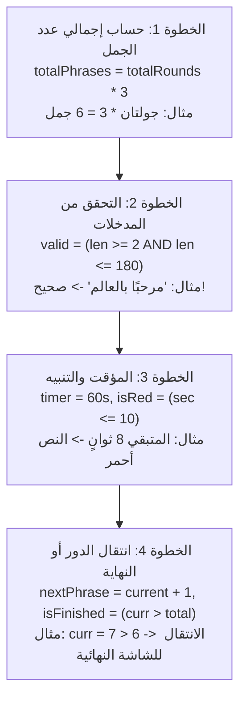

# 🧩 تحليل الخوارزمية خطوة بخطوة — لعبة "BlindStory"

---

## 1. المشكلة بالنسبة للطالب

كيف يعرف التطبيق متى يكون دور اللاعب، وهل النص المدخل صحيح، ومتى يتم تنبيه اللاعب بانتهاء الوقت، ومتى تنتهي اللعبة تمامًا؟

بدون خوارزمية، لا يمكن للكمبيوتر تخمين متى تنتهي القصة. تقوم **خوارزمية التقدم والتحقق** بحساب إجمالي الجولات، والتحقق من طول الجملة في الوقت الفعلي، وإدارة مؤقت الـ 60 ثانية مع تنبيه في آخر 10 ثوانٍ.

---

## 2. مخطط الخوارزمية (Mermaid flowchart TD)



---

## 3. شرح الكود بخطوات

```java
// حساب إجمالي الجمل
totalPhrases = totalRounds * 3;

// التحقق من طول الجملة (بين 2 و 180 حرفًا)
btnSubmitPhrase.setEnabled(length >= 2 && length <= 180);

// تنبيه آخر 10 ثوانٍ باللون الأحمر
if (secondsLeft <= 10) {
    tvGameTimer.setTextColor(ContextCompat.getColor(GameActivity.this, R.color.warning_red));
}

// الانتقال للشاشة النهائية عند انتهاء الجمل
if (currentPhraseNumber > totalPhrases) {
    Intent intent = new Intent(GameActivity.this, FinalStoryActivity.class);
    startActivity(intent);
    finish();
}
```
