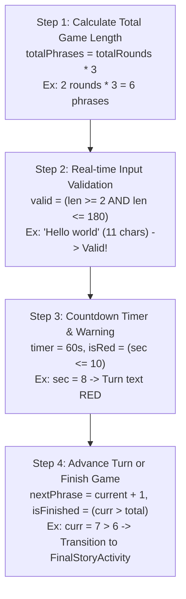

# 🧩 Algorithm Step-by-Step Breakdown — "BlindStory" Game Progress & Validation Algorithm

---

## 1. The Problem for the Student

In a multiplayer game like **BlindStory**, how does the application know when it's a player's turn, whether the phrase typed is valid, when to alert the player about expiring time, and when the game is completely finished?

Without an algorithm, a computer cannot guess when a story ends or whether a message is too short or too long. The **Game Progress & Validation Algorithm** calculates total story length, validates phrase constraints in real time, manages a 60-second countdown timer with a 10-second warning threshold, and advances turns seamlessly until triggering the final story screen.

---

## 2. Algorithm Flowchart (Mermaid flowchart TD)



### ASCII Conversion & Progress Scale
```
[Game Created: 2 Rounds * 3 Players] ──> [Total: 6 Phrases] ──> [Turns 1..6] ──> [Finish > 6]
```

| Step | Operation | Formula / Condition | Numerical Example |
|---|---|---|---|
| **1** | Total Phrases Calculation | `totalPhrases = totalRounds * 3` | `2 * 3 = 6 phrases` |
| **2** | Input Validation | `len >= 2 && len <= 180` | `11 chars -> Enabled` |
| **3** | Timer Warning | `secondsLeft <= 10` | `8s -> RED Warning` |
| **4** | Turn Advance / Finish | `currentPhraseNumber > totalPhrases` | `7 > 6 -> Open Final` |

---

## 3. Real-Life Analogy: Relay Race with Shot Clock 🏃💨

Imagine a **3-person relay race**:
1. **Total Laps:** The referee announces each runner must run 2 laps. With 3 runners, that's `2 * 3 = 6 total laps`.
2. **Baton Transfer:** Each runner has 60 seconds to pass the baton. If the timer hits 10 seconds, a red warning light flashes!
3. **Baton Validity:** Your message on the baton must be between 2 and 180 letters. Too short or too long, and you can't pass it!
4. **Finish Line:** Once lap 6 is completed, runner 7 doesn't run—instead, the judges announce the race is complete and unfold the final banner!

---

## 4. Step-by-Step Breakdown

### Step 1: Calculate Total Game Length
- **What it does:** Calculates how many total phrases will be written before opening the final screen.
- **Formula:**
  $$\text{totalPhrases} = \text{totalRounds} \times 3$$
- **Numerical Example:**
  With `totalRounds = 2`, `totalPhrases = 2 * 3 = 6`.
- **Java Code:**
  ```java
  // In GameActivity.java
  totalRounds = getIntent().getIntExtra(EXTRA_TOTAL_ROUNDS, 2);
  totalPhrases = totalRounds * 3; // 3 players * totalRounds
  ```

---

### Step 2: Real-time Input Validation
- **What it does:** Monitors user typing in real time and enables the "Submit Phrase" button only when phrase length is between 2 and 180 characters.
- **Condition:**
  $$\text{isSubmitEnabled} = (\text{length} \ge 2 \text{ AND } \text{length} \le 180)$$
- **Numerical Example:**
  - User types `"Hi"` (length = 2) -> `2 >= 2` AND `2 <= 180` -> Button Enabled!
  - User types `"A"` (length = 1) -> `1 < 2` -> Button Disabled.
  - User types 185 characters -> `185 > 180` -> Button Disabled, counter turns RED!
- **Java Code:**
  ```java
  // In GameActivity.java setupInputWatcher()
  int length = s != null ? s.length() : 0;
  tvCharCounter.setText(getString(R.string.game_char_counter, length, 180));

  if (length > 180) {
      tvCharCounter.setTextColor(ContextCompat.getColor(GameActivity.this, R.color.warning_red));
  } else {
      tvCharCounter.setTextColor(ContextCompat.getColor(GameActivity.this, R.color.text_secondary));
  }

  btnSubmitPhrase.setEnabled(length >= 2 && length <= 180);
  ```

---

### Step 3: Countdown Timer & Warning Threshold
- **What it does:** Runs a 60-second CountDownTimer that ticks every second and changes timer color to RED when <= 10 seconds remain.
- **Condition:**
  $$\text{isRedWarning} = (\text{secondsLeft} \le 10)$$
- **Numerical Example:**
  At 45s -> Color is Primary Text (Black/Dark). At 8s -> `8 <= 10` -> Color changes to Warning Red (`#D32F2F`).
- **Java Code:**
  ```java
  // In GameActivity.java startTurnTimer()
  turnTimer = new CountDownTimer(60000, 1000) {
      @Override
      public void onTick(long millisUntilFinished) {
          long secondsLeft = millisUntilFinished / 1000;
          String timerText = String.format(Locale.getDefault(), "00:%02d", secondsLeft);
          tvGameTimer.setText(timerText);

          if (secondsLeft <= 10) {
              tvGameTimer.setTextColor(ContextCompat.getColor(GameActivity.this, R.color.warning_red));
          } else {
              tvGameTimer.setTextColor(ContextCompat.getColor(GameActivity.this, R.color.text_primary));
          }
      }
      // ...
  }.start();
  ```

---

### Step 4: Advance Turn or Finish Game
- **What it does:** Appends submitted phrase to story list, increments `currentPhraseNumber`, and checks if game is completed.
- **Condition:**
  $$\text{isGameFinished} = (\text{currentPhraseNumber} > \text{totalPhrases})$$
- **Numerical Example:**
  - Turn 6 submitted: `currentPhraseNumber` becomes `7`.
  - Condition check: `7 > 6` -> True! Launch `FinalStoryActivity`.
- **Java Code:**
  ```java
  // In GameActivity.java advanceToNextTurn()
  storyPhrases.add(submittedPhrase);
  currentPhraseNumber++;

  if (currentPhraseNumber > totalPhrases) {
      Intent intent = new Intent(GameActivity.this, FinalStoryActivity.class);
      intent.putExtra(FinalStoryActivity.EXTRA_ROOM_NAME, roomName);
      intent.putStringArrayListExtra(FinalStoryActivity.EXTRA_STORY_PHRASES, new ArrayList<>(storyPhrases));
      startActivity(intent);
      finish();
      return;
  }

  updateTurnUi();
  ```

---

## ⚠️ Edge Cases

1. **Empty String or 1 Character:**
   - User types `"a"`. `length = 1`. Button stays disabled, preventing empty phrase submissions.
2. **Exceeding 180 Characters:**
   - User pastes 200 characters. Counter displays `200 / 180` in RED, submit button is immediately disabled.
3. **Timer Expiration (0 seconds):**
   - If player doesn't submit in 60s, `onFinish()` is called, phrase is saved as ` "..." `, and turn passes automatically to prevent game stall.

---

## 🔑 What's Important to Remember

1. **Off-by-One Protection:** Incrementing `currentPhraseNumber` happens *after* appending the phrase, ensuring exact phrase counting.
2. **Memory Leak Prevention:** Always cancel timers in `onDestroy()` using `turnTimer.cancel()`.
3. **User Feedback:** Dynamic color changes (text length counter and timer warning) guide the user without interrupting gameplay.

---

## ❌ Common Student Mistakes

1. **Forgetting `turnTimer.cancel()`:** Leaving a CountDownTimer running when leaving an Activity causes background memory leaks and crash errors.
2. **Off-by-One Array Errors:** Trying to read `storyPhrases.get(currentPhraseNumber)` without checking list boundaries.
3. **Hardcoding Total Rounds:** Forgetting that total phrases depends on the number of players (`rounds * 3`).

---

## ❓ Self-Check Questions

1. **Calculation:** If a room has 3 rounds, how many total phrases will be written in the game? *(Answer: 3 * 3 = 9 phrases)*.
2. **Threshold:** At how many remaining seconds does the timer text turn RED in `GameActivity`? *(Answer: 10 seconds or fewer)*.
3. **Validation:** Will a phrase with 180 characters be accepted by `btnSubmitPhrase`? *(Answer: Yes, because 180 <= 180 is true)*.
4. **Code Improvement Task:** Write a small modification in `submitPhrase()` that strips leading and trailing spaces using `.trim()` before calculating string length!
