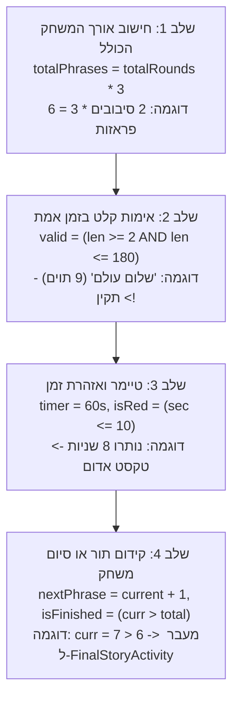

# 🧩 ניתוח אלגוריתם שלב אחר שלב — אלגוריתם התקדמות המשחק ואימות הקלט ב-"BlindStory"

---

## 1. הבעיה עבור התלמיד

במשחק קבוצתי כמו **BlindStory**, איך האפליקציה יודעת מתי מגיע תורו של שחקן, האם הטקסט שהקליד תקין, מתי להזהיר אותו שהזמן אוזל, ומתי המשחק הסתיים לחלוטין?

ללא אלגוריתם, מחשב אינו יכול לנחש מתי סיפור מסתיים או האם הודעה קצרה או ארוכה מדי. **אלגוריתם התקדמות המשחק ואימות הקלט** מחשב את מספר הפראזות הכולל בסיפור, מאמת את אורך הטקסט בזמן אמת, מנהל טיימר של 60 שניות עם סף אזהרה ב-10 השניות האחרונות, ומעביר תורות עד להגעת מסך הסיום.

---

## 2. סכמת האלגוריתם (Mermaid flowchart TD)



| שלב | פעולה | נוסחה / תנאי | דוגמה מספרית |
|---|---|---|---|
| **1** | חישוב סך הפראזות | `totalPhrases = totalRounds * 3` | `2 * 3 = 6 פראזות` |
| **2** | אימות קלט | `len >= 2 && len <= 180` | `9 תוים -> כפתור פעיל` |
| **3** | אזהרת טיימר | `secondsLeft <= 10` | `8 שניות -> טקסט אדום` |
| **4** | קידום תור / סיום | `currentPhraseNumber > totalPhrases` | `7 > 6 -> פתיחת פינאל` |

---

## 3. אנלוגיה מהחיים: מרוץ שליחים עם שעון עצר 🏃💨

דמיינו **מרוץ שליחים של 3 רצים**:
1. **סך הסיבובים:** השופט קובע שכל רץ ירוץ 2 סיבובים. עם 3 רצים, זה `2 * 3 = 6 סיבובים בסך הכל`.
2. **העברת מקל:** לכל רץ יש 60 שניות להעביר את המקל. כשהשעון מגיע ל-10 שניות, נדלקת נורת אזהרה אדומה!
3. **תקינות ההודעה:** ההודעה שרשומה על המקל חייבת להיות בין 2 ל-180 אותיות.
4. **קו הסיום:** ברגע שהסיבוב ה-6 מסתיים, הרץ ה-7 לא רץ — במקום זאת, השופטים עוצרים את המרוץ ופותחים את שלט הסיום!

---

## 4. ניתוח לפי שלבים

### שלב 1: חישוב אורך המשחק הכולל
- **מה עושים:** מחשבים כמה פראזות ייכתבו בסך הכל בסיפור.
- **נוסחה:**
  $$\text{totalPhrases} = \text{totalRounds} \times 3$$
- **דוגמה מספרית:**
  עם `totalRounds = 2`, התוצאה היא `2 * 3 = 6 פראזות`.
- **איך זה נראה ב-Java:**
  ```java
  totalRounds = getIntent().getIntExtra(EXTRA_TOTAL_ROUNDS, 2);
  totalPhrases = totalRounds * 3; // 3 שחקנים * מספר סיבובים
  ```

---

### שלב 2: אימות קלט בזמן אמת
- **מה עושים:** בודקים את אורך הטקסט שהוקלד ומאפשרים את כפתור השליחה רק כשהאורך בין 2 ל-180 תוים.
- **תנאי:**
  $$\text{isSubmitEnabled} = (\text{length} \ge 2 \text{ AND } \text{length} \le 180)$$
- **דוגמה מספרית:**
  - הקלדה של `"היי"` (אורך 3) -> `3 >= 2` וגם `3 <= 180` -> הכפתור ירוק ופעיל!
  - הקלדה של תו אחד `"א"` (אורך 1) -> הכפתור כבוי.
- **איך זה נראה ב-Java:**
  ```java
  int length = s != null ? s.length() : 0;
  tvCharCounter.setText(getString(R.string.game_char_counter, length, 180));
  btnSubmitPhrase.setEnabled(length >= 2 && length <= 180);
  ```

---

### שלב 3: טיימר ואזהרת זמן
- **מה עושים:** מפעילים `CountDownTimer` ל-60 שניות. כשהזמן יורד ל-10 שניות ומטה, צבע הטקסט משתנה לאדום.
- **תנאי:**
  $$\text{isRedWarning} = (\text{secondsLeft} \le 10)$$
- **איך זה נראה ב-Java:**
  ```java
  if (secondsLeft <= 10) {
      tvGameTimer.setTextColor(ContextCompat.getColor(GameActivity.this, R.color.warning_red));
  }
  ```

---

### שלב 4: קידום תור או סיום משחק
- **מה עושים:** מוסיפים את הפראזה לרשימת הסיפור, מקדמים את המונה, ובודקים אם הגענו לסוף.
- **תנאי:**
  $$\text{isGameFinished} = (\text{currentPhraseNumber} > \text{totalPhrases})$$
- **איך זה נראה ב-Java:**
  ```java
  storyPhrases.add(submittedPhrase);
  currentPhraseNumber++;

  if (currentPhraseNumber > totalPhrases) {
      Intent intent = new Intent(GameActivity.this, FinalStoryActivity.class);
      startActivity(intent);
      finish();
      return;
  }
  ```

---

## ❓ שאלות לבדיקה עצמית

1. **חישוב:** אם בחדר מוגדרים 3 סיבובים, כמה פראזות ייכתבו בסך הכל בסיפור? *(תשובה: 3 * 3 = 9 פראזות)*.
2. **סף אזהרה:** באיזה מספר שניות נותרות צבע הטיימר הופך לאדום ב-`GameActivity`? *(תשובה: 10 שניות או פחות)*.
3. **אימות:** האם פראזה באורך 180 תוים בדיוק תאושר למשלוח? *(תשובה: כן, כי 180 <= 180 זה נכון)*.
