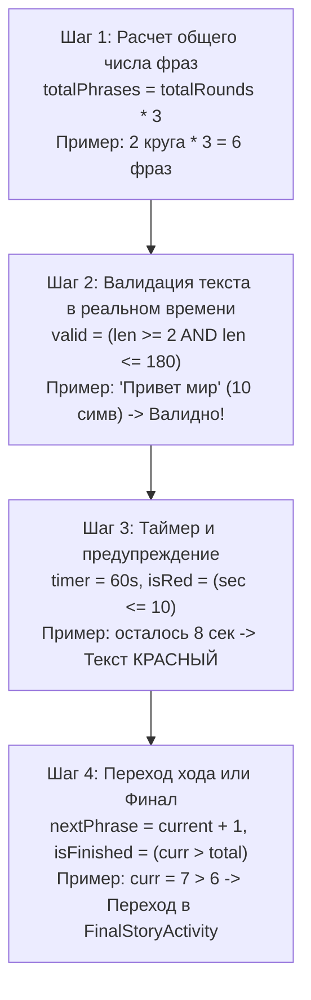

# 🧩 Пошаговый разбор алгоритма — «Слепой рассказ»

---

## 1. Проблема для учащегося

Как в коллективной игре **«Слепой рассказ»** приложение узнает, чей сейчас ход, валиден ли введенный текст, когда предупредить игрока о заканчивающемся времени и когда игра полностью завершена?

Без алгоритма компьютер не способен угадать, где заканчивается история и соблюдает ли игрок правила ввода. **Алгоритм прогресса игры и валидации** рассчитывает общее число фраз, проверяет длину текста в реальном времени, управляет 60-секундным таймером с подсветкой последних 10 секунд и переводит ход вплоть до финального экрана.

---

## 2. Схема алгоритма (Mermaid flowchart TD)



| Шаг | Действие | Формула / Условие | Числовой пример |
|---|---|---|---|
| **1** | Расчет общего числа фраз | `totalPhrases = totalRounds * 3` | `2 * 3 = 6 фраз` |
| **2** | Валидация ввода | `len >= 2 && len <= 180` | `10 симв -> Кнопка активна` |
| **3** | Предупреждение таймера | `secondsLeft <= 10` | `8 секунд -> КРАСНЫЙ текст` |
| **4** | Переход / Финал | `currentPhraseNumber > totalPhrases` | `7 > 6 -> Открытие Финала` |

---

## 3. Наглядная аналогия: Эстафета с секундомером 🏃💨

Представьте **эстафету из 3 бегунов**:
1. **Число кругов:** Судья объявляет, что каждый должен пробежать по 2 круга. С 3 бегунами это `2 * 3 = 6 кругов всего`.
2. **Передача эстафеты:** У каждого бегуна есть 60 секунд. Когда остается 10 секунд, загорается красный сигнал!
3. **Правило эстафетной палочки:** Записка должна содержать от 2 до 180 букв.
4. **Финиш:** Как только 6-й круг завершен, 7-й бегун не бежит — судьи останавливают эстафету и разворачивают финальный баннер!

---

## 4. Пошаговый разбор кода

### Шаг 1: Расчет общего числа фраз
```java
// В GameActivity.java
totalRounds = getIntent().getIntExtra(EXTRA_TOTAL_ROUNDS, 2);
totalPhrases = totalRounds * 3; // 3 игрока * число кругов
```

### Шаг 2: Валидация текста в реальном времени
```java
// В GameActivity.java
int length = s != null ? s.length() : 0;
tvCharCounter.setText(getString(R.string.game_char_counter, length, 180));
btnSubmitPhrase.setEnabled(length >= 2 && length <= 180);
```

### Шаг 3: Таймер и подсвечивание
```java
// В GameActivity.java
if (secondsLeft <= 10) {
    tvGameTimer.setTextColor(ContextCompat.getColor(GameActivity.this, R.color.warning_red));
}
```

### Шаг 4: Переход хода и открытие Финала
```java
// В GameActivity.java
storyPhrases.add(submittedPhrase);
currentPhraseNumber++;

if (currentPhraseNumber > totalPhrases) {
    Intent intent = new Intent(GameActivity.this, FinalStoryActivity.class);
    startActivity(intent);
    finish();
    return;
}
```

---

## ❓ Вопросы для самопроверки

1. **Расчет:** Если в комнате выбрано 3 круга, сколько всего фраз будет в рассказе? *(Ответ: 3 * 3 = 9 фраз)*.
2. **Порог:** При скольких оставшихся секундах таймер краснеет в `GameActivity`? *(Ответ: 10 секунд или меньше)*.
3. **Валидация:** Будет ли отправлена фраза длиной ровно 180 символов? *(Ответ: Да, так как 180 <= 180 истинно)*.
