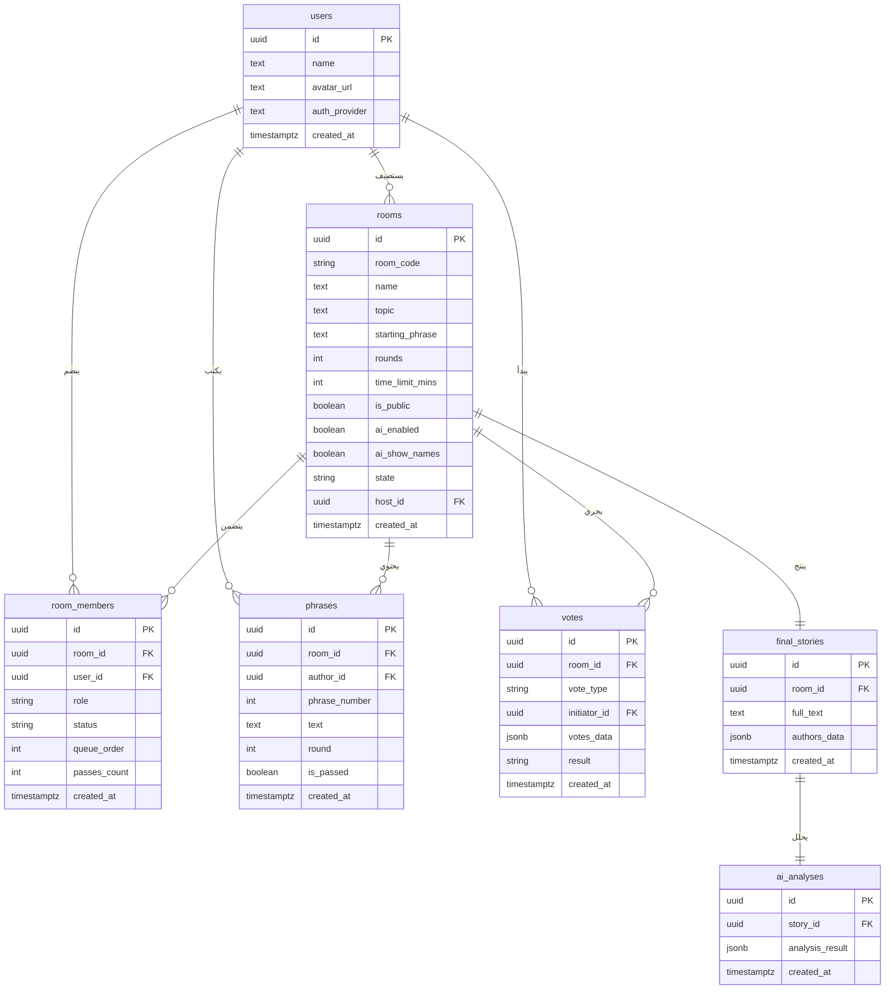

# 🧩 مخطط الكيانات والعلاقات (ER-Diagram) لقاعدة البيانات — "BlindStory"

---

## 1. مخطط الكيانات والعلاقات (Mermaid erDiagram)

---

## 2. كيفية قراءة المخطط

| الرمز | المعنى |
|---|---|
| **صندوق الكيان (`users`, `rooms`)** | جدول قاعدة بيانات يحفظ السجلات. |
| **الحقل (`id`, `name`, `text`)** | عمود يضم عنصر بيانات محدد. |
| **PK (المفتاح الرئيسي)** | المعرف الفريد لكل صف. |
| **FK (المفتاح الأجنبي)** | رابط يشير لمفتاح رئيسي في جدول آخر. |
| `||--o{` | **علاقة واحد إلى متعدد:** صف واحد يرتبط بعدة صفوف. |
| `||--||` | **علاقة واحد لواحد:** صف واحد يرتبط بصف واحد فقط. |

---

## 3. شرح بكلمات بسيطة

### 💡 الفكرة الرئيسية
لماذا نحتاج قاعدة بيانات؟ المتغيرات تختفي عند إغلاق التطبيق. تحفظ قاعدة البيانات (Supabase PostgreSQL) البيانات بشكل دائم على الخادم!
