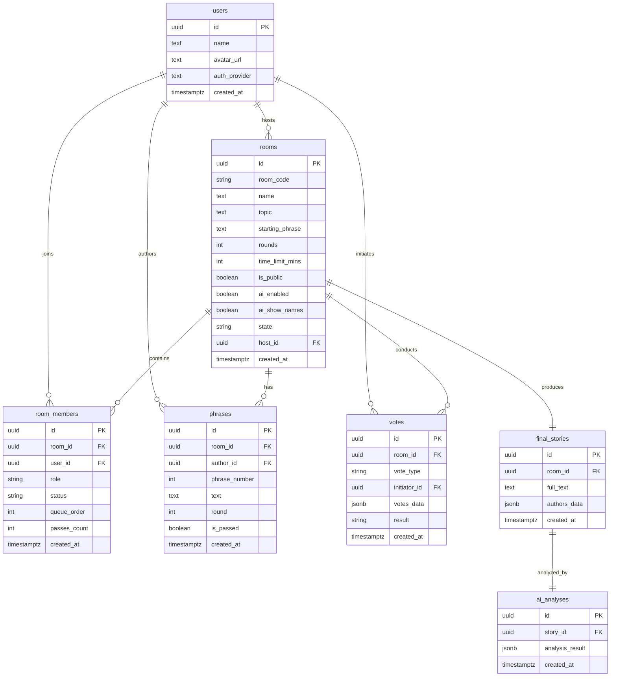

# 🧩 Database ER-Diagram & Detailed Explanation — "BlindStory"

---

## 1. Database ER-Diagram (Mermaid erDiagram)



---

## 2. How to Read the ER-Diagram

| Symbol in Diagram | Meaning |
|---|---|
| **Entity Box (`users`, `rooms`)** | A database table storing rows of records. |
| **Field (`id`, `name`, `text`)** | A column in the table holding a specific piece of data. |
| **PK (Primary Key)** | The unique identifier for each row in that table. |
| **FK (Foreign Key)** | A pointer linking a row to a Primary Key in another table. |
| `||--o{` | **One-to-Many Relationship:** One parent row relates to zero, one, or many child rows. |
| `||--||` | **One-to-One Relationship:** One parent row relates to exactly one child row. |
| `"hosts"`, `"contains"` | Verb describing the relationship between tables. |

---

## 3. Simplified Explanation

### 💡 Core Concept
Why do we need a database if we have variables in Java? When an app closes or a phone restarts, RAM variables disappear! A database stores structured data permanently on disk or on a remote cloud server (Supabase PostgreSQL).

### 📚 Real-Life Analogy: School Gradebook
Imagine a school gradebook:
- One table lists **Students** (ID, Full Name, Class).
- Another table lists **Grades** (Grade ID, Student ID, Subject, Score).
- Instead of repeating the student's name on every single grade entry, we store the `Student ID` as a link (**Foreign Key**).

---

### 🗄️ Detailed Table Analysis

#### 1. `users` Table
Stores registered player accounts.
- `id` (UUID, PK): Unique user ID (e.g. `u1111111-2222-3333-4444-555555555555`).
- `name` (TEXT): Display name (e.g. `"Cat"`).
- `auth_provider` (TEXT): `"email"` or `"google"`.

#### 2. `rooms` Table
Stores created game rooms.
- `id` (UUID, PK): Room unique ID.
- `room_code` (VARCHAR): 6-character code (e.g. `"KOT123"`).
- `name` & `topic` (TEXT): Room name (`"Cosmos"`) and theme.
- `host_id` (UUID, FK): Points to `users.id` of the host player.

#### 3. `room_members` Table
Junction table mapping which players belong to which rooms.
- `room_id` (FK -> `rooms.id`)
- `user_id` (FK -> `users.id`)
- `role` (VARCHAR): `'host'` or `'member'`.

#### 4. `phrases` Table
Stores phrases submitted during active gameplay.
- `room_id` (FK): The room this phrase belongs to.
- `author_id` (FK): The user who wrote it.
- `phrase_number` (INT): Order in the story (`1`, `2`, `3`...).
- `text` (TEXT): The phrase text (e.g. `"He decided the key opens a portal to the past."`).

#### 5. `final_stories` & `ai_analyses` Tables
Store completed stories and generated AI commentator feedback.

---

### 🔗 Keys and Relationships Example

- **`rooms` (1) ── (N) `phrases`**: One room contains many phrases.
- **CASCADE Delete Rule (`ON DELETE CASCADE`)**: If a room is deleted, PostgreSQL automatically deletes all associated `room_members`, `phrases`, `votes`, and `final_stories`. No orphan records remain!

---

### 💻 Connection to SQL & Java Code

#### Creating Table (SQL)
```sql
CREATE TABLE public.phrases (
    id UUID PRIMARY KEY DEFAULT gen_random_uuid(),
    room_id UUID REFERENCES public.rooms(id) ON DELETE CASCADE,
    author_id UUID REFERENCES public.users(id) ON DELETE SET NULL,
    phrase_number INT NOT NULL,
    text TEXT NOT NULL,
    created_at TIMESTAMPTZ DEFAULT now()
);
```

#### Fetching Current Turn Phrase via RPC Function
```sql
CREATE OR REPLACE FUNCTION public.get_current_turn_phrase(p_room_id UUID)
RETURNS TABLE (phrase_number INT, text TEXT, round INT) 
LANGUAGE plpgsql SECURITY DEFINER AS $$
BEGIN
    RETURN QUERY
    SELECT p.phrase_number, p.text, p.round
    FROM public.phrases p
    WHERE p.room_id = p_room_id
    ORDER BY p.phrase_number DESC LIMIT 1;
END;
$$;
```

---

## ❓ Self-Check Questions
1. **Single Row:** What does a single row in the `phrases` table represent? (Answer: One submitted phrase in a game story).
2. **Foreign Key:** Why is `host_id` in `rooms` a Foreign Key pointing to `users.id`? (Answer: To identify which user is the host without duplicating user data).
3. **Cascade Rule:** What happens to the `phrases` of a room if the `room` row is deleted? (Answer: They are automatically deleted via `ON DELETE CASCADE`).
4. **Schema Modification Task:** Add a new table `achievements` (id PK, title, icon) and link it to `users` via `user_achievements` junction table!
