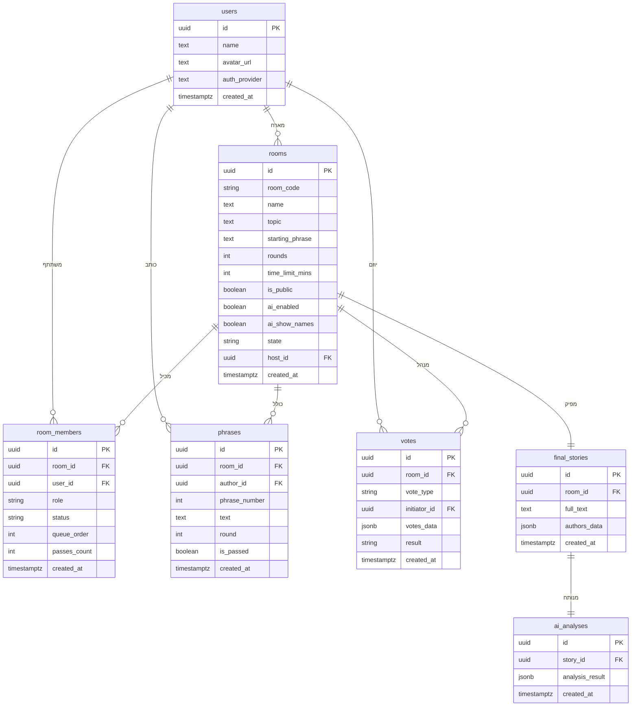

# 🧩 סכמת בסיס נתונים (ER-Diagram) ותיאור מפורט — "BlindStory"

---

## 1. דיאגרמת ER לבסיס הנתונים (Mermaid erDiagram)

---

## 2. איך לקרוא את הדיאגרמה

| אלמנט בדיאגרמה | מה זה אומר |
|---|---|
| **מלבן ישות (`users`, `rooms`)** | טבלת בסיס נתונים המאחסנת שורות של רשומות. |
| **שדה (`id`, `name`, `text`)** | עמודה בטבלה המחזיקה נתון ספציפי. |
| **PK (Primary Key - מפתח ראשי)** | מזהה ייחודי עבור כל שורה בטבלה זו. |
| **FK (Foreign Key - מפתח זר)** | קישור המצביע על מפתח ראשי בטבלה אחרת. |
| `||--o{` | **קשר אחד-לרבים:** שורת אב אחת קשורה לאפס, אחת או הרבה שורות בנות. |
| `||--||` | **קשר אחד-לאחד:** שורת אב אחת קשורה בדיוק לשורת בת אחת. |

---

## 3. הסבר במילים פשוטות

### 💡 הרעיון המרכזי
למה צריך בסיס נתונים אם יש משתנים ב-Java? כשסוגרים אפליקציה או מפעילים מחדש את הטלפון, משתנים בזיכרון ה-RAM נעלמים! בסיס נתונים (Supabase PostgreSQL) שומר נתונים מובנים באופן קבוע בשרת באינטרנט.

### 📚 אנלוגיה מהחיים: יומן בית ספר
דמיינו יומן בית ספר:
- טבלה אחת מחזיקה את רשימת **התלמידים** (תעודת זהות, שם מלא, כיתה).
- טבלה נפרדת מחזיקה את **הציונים** (מזהה ציון, מזהה תלמיד, מקצוע, ציון).
- במקום לרשום את שם התלמיד המלא ליד כל ציון, רושמים רק את מזהה התלמיד (Foreign Key).

---

## ❓ שאלות לבדיקה עצמית
1. **שורה יחידה:** מה מייצגת שורה אחת בטבלת `phrases`? (תשובה: פראזה יחידה שנשלחה בתוך משחק).
2. **מפתח זר:** למה `host_id` בטבלת `rooms` הוא מפתח זר שמצביע על `users.id`? (תשובה: כדי לדעת מי המארח מבלי לשכפל את כל פרטי המשתמש).
3. **כלל מחיקה:** מה יקרה לפראזות בטבלת `phrases` אם שורת ה-`room` שלהן תימחק? (תשובה: הן יימחקו אוטומטית הודות ל-`ON DELETE CASCADE`).
