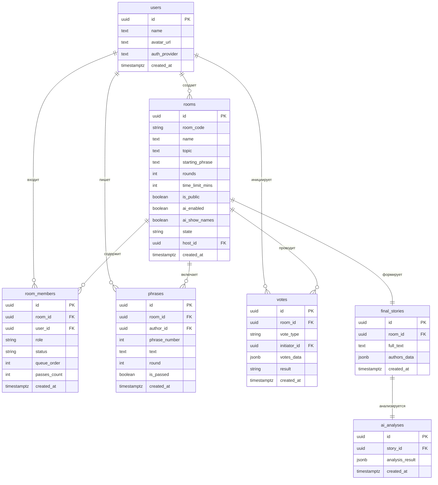

# 🧩 ER-Диаграмма базы данных и подробное объяснение — «Слепой рассказ»

---

## 1. ER-Диаграмма базы данных (Mermaid erDiagram)

---

## 2. Как читать ER-Диаграмму

| Символ на диаграмме | Что это значит |
|---|---|
| **Сущность (`users`, `rooms`)** | Таблица базы данных, хранящая строки записей. |
| **Поле (`id`, `name`, `text`)** | Колонка таблицы, содержащая конкретный элемент данных. |
| **PK (Primary Key)** | Первичный ключ — уникальный идентификатор каждой строки. |
| **FK (Foreign Key)** | Внешний ключ — ссылка на первичный ключ в другой таблице. |
| `||--o{` | **Один-ко-Многим:** одна запись родителя связана с 0, 1 или несколькими записями. |
| `||--||` | **Один-к-Одному:** одна запись строго связана с одной записью. |

---

## 3. Объяснение простыми словами

### 💡 Главная идея
Зачем нужна база данных, если есть переменные в Java? Переменные в оперативной памяти сбрасываются при закрытии приложения! База данных (Supabase PostgreSQL) надежно хранит данные на сервере в интернете.

### 📚 Наглядная аналогия: Школьный журнал
- Таблица **Ученики** (ID ученика, Имя, Класс).
- Таблица **Оценки** (ID оценки, ID ученика, Предмет, Оценка).
- Вместо того чтобы писать имя ученика в каждой оценке, мы ставим `ID ученика` как ссылку (Внешний ключ / Foreign Key).

---

## ❓ Вопросы для самопроверки
1. **Одна запись:** Что хранит одна строка в таблице `phrases`? (Ответ: Одну отправленную фразу рассказа).
2. **Внешний ключ:** Зачем поле `host_id` в `rooms` ссылается на `users.id`? (Ответ: Чтобы знать, кто ведущий комнаты, без дублирования его имени и данных).
3. **Каскадное удаление:** Что произойдет с фразами в `phrases`, если удалить комнату в `rooms`? (Ответ: Они автоматически удалятся благодаря `ON DELETE CASCADE`).
