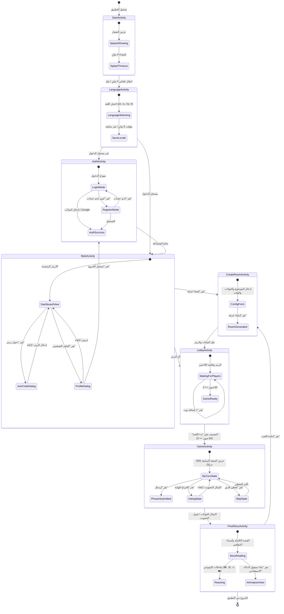
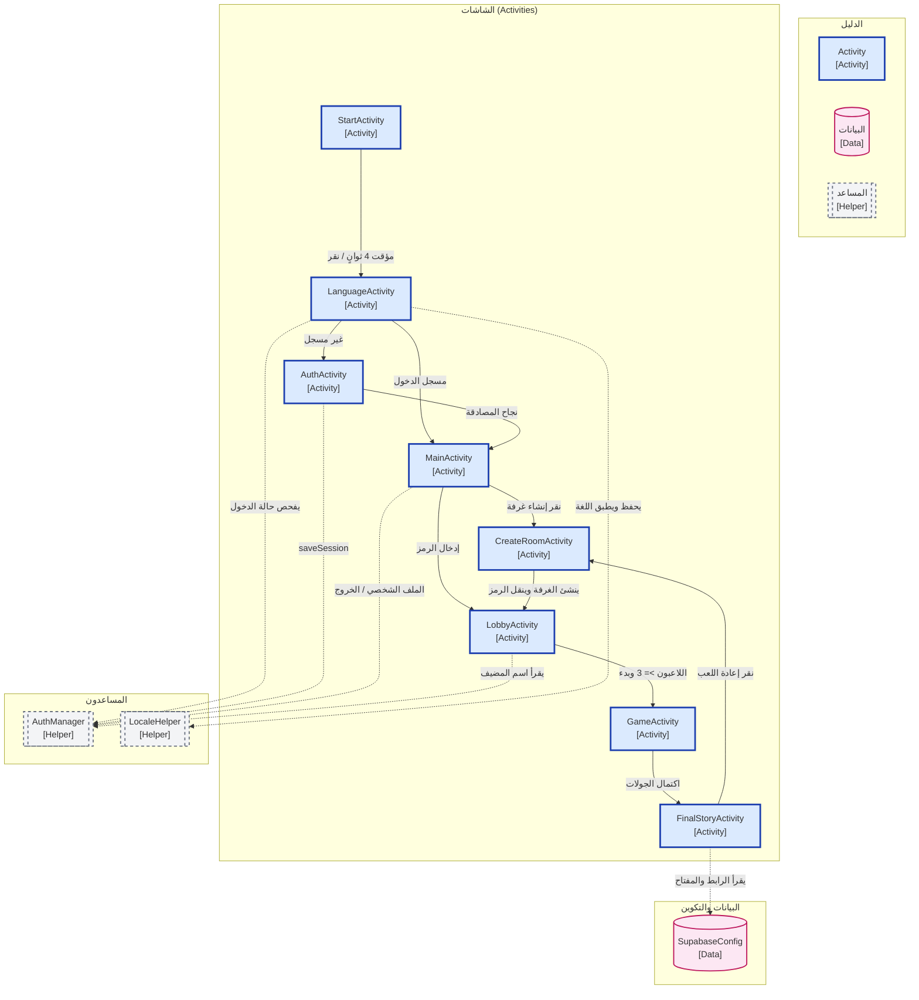

# 🧩 مخطط التنقل والحالات وخريطة الفئات — "BlindStory"

---

## 1. המخطط 1: التنقل والحالات (Mermaid stateDiagram-v2)

---

## 2. المخطط 2: خريطة الفئات (Mermaid flowchart TD)

---

## 3. شرح بكلمات بسيطة

### 💡 الفكرة الرئيسية
في أي لحظة يكون التطبيق في **حالة واحدة بالضبط**. حادث خارجي (نقر، مؤقت) ينقله إلى الحالة التالية. في علوم الحاسوب يُسمى هذا **آلة الحالات المنتهية (Finite State Machine)**.

### 🚦 تشبيه من الحياة: البوابة الإلكترونية
- **الحالة 1: مقفلة.** تنتظر التذكرة.
- **الحدث: تمرير التذكرة.**
- **الانتقال:** تفتح البوابة.
- **الحالة 2: مفتوحة.** يمر المسافر.
- **الحدث: استشعار المرور.**
- **الانتقال:** تعود للحالة 1 (مقفلة).
