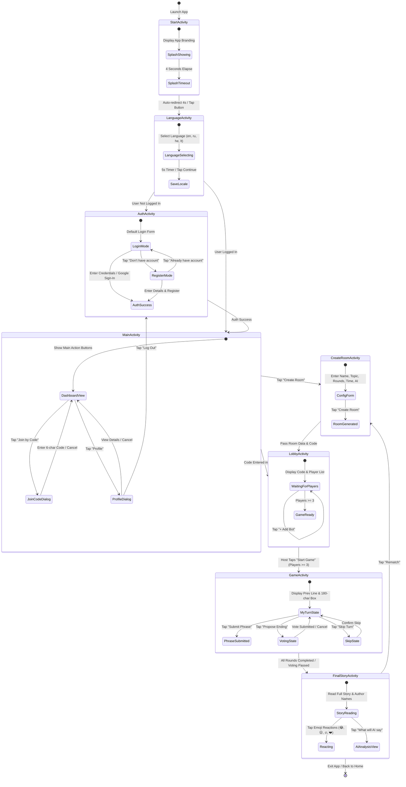
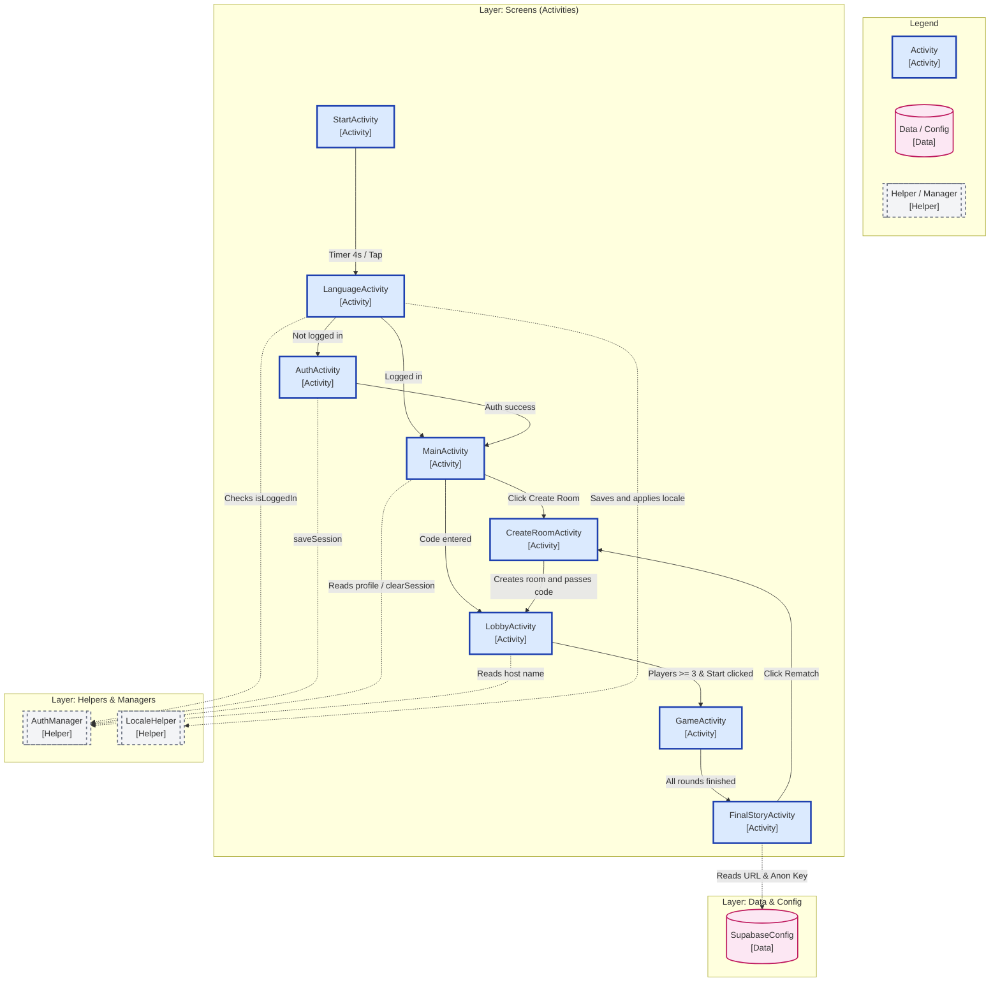

# 🧩 State Navigation & Class Relationship Map — "BlindStory"

---

## 1. Diagram 1: State & Navigation (Mermaid stateDiagram-v2)



---

## 2. Diagram 2: Class & Relationship Map (Mermaid flowchart TD)



---

## 3. How to Read Diagram 1

| Element in Diagram 1 | What It Means |
|---|---|
| `[*]` at Start / End | Application entry point / Application exit. |
| **State Box** | Screen or user view state (e.g. `StartActivity`, `MyTurnState`). |
| **Composite State (`state X { ... }`)** | A screen containing internal states (e.g. `AuthActivity` toggling between Login and Registration). |
| **Transition Arrow** | An event or condition triggering state transition. |

---

## 4. How to Read Diagram 2

| Element in Diagram 2 | Shape & Color | Class Type & Example |
|---|---|---|
| **Activity** | Blue rectangle `[ ]`, thick border | `MainActivity<br/>[Activity]` |
| **Helper** | Gray dashed rectangle `[[ ]]` | `AuthManager<br/>[Helper]` |
| **Data** | Pink cylinder `[( )]` | `SupabaseConfig<br/>[Data]` |
| `-->` Solid Arrow | Solid Line | **Navigation** (`startActivity`, `Intent`). |
| `-.->` Dashed Arrow | Dashed Line | **Usage / Calls Method** (`AuthManager.isLoggedIn()`). |
| `==>` Thick Arrow | Double Line | **Data Flow** (`saveSession`, `loadLocale`). |

---

## 5. Simplified Explanation

### 💡 Core Concept
At any given millisecond, an application is in **exactly one state**. An external event (user tap, timer timeout, network response) triggers a **transition** to the next state. In computer science theory, this is known as a **Finite State Machine (FSM)**.

### 🚦 Real-Life Analogy: A Subway Turnstile
- **State 1: Locked.** Waiting for token.
- **Event: Tap Card.**
- **Transition:** Lock releases.
- **State 2: Unlocked.** User passes through.
- **Event: Sensor detects pass.**
- **Transition:** Returns to State 1 (Locked).

---

### 🔍 App Lifecycle & Screen States
1. **Launch Chain:**
   - `StartActivity` shows branding for **4 seconds**.
   - `LanguageActivity` presents 4 languages for **5 seconds**. If untouched, auto-saves default language (`"en"`) via `LocaleHelper`.
   - Checks `AuthManager.isLoggedIn()`. If logged in -> `MainActivity`, else -> `AuthActivity`.
2. **Main Screen & Lobby:**
   - `CreateRoomActivity` configures parameters and generates a 6-character code (e.g. `KOT123`).
   - `LobbyActivity` displays code and player count. The "Start Game" button stays disabled (*"Need at least 3 players (1/3)"*) until count >= 3.
3. **Active Game (`GameActivity`):**
   - User sees **only the previous phrase** ("sheet of paper").
   - 60-second turn timer (turns red during last 10 seconds).
   - Character counter (`0 / 180`), submit button enabled for 2-180 chars.
   - Lock on submit: Shows *"Your phrase has been accepted!"*.

---

### 💻 Connection to Java Code

#### Navigation (`-->`)
```java
// LobbyActivity --> GameActivity
Intent intent = new Intent(LobbyActivity.this, GameActivity.class);
startActivity(intent);
```

#### Helper Usage (`-.->`)
```java
// LanguageActivity -.-> AuthManager
if (AuthManager.isLoggedIn(this)) {
    Intent intent = new Intent(LanguageActivity.this, MainActivity.class);
    startActivity(intent);
}
```

---

## ❓ Self-Check Questions
1. **Exact Value:** How many seconds does `StartActivity` display before auto-redirecting? (Answer: 4 seconds).
2. **Threshold:** How many players must join `LobbyActivity` before "Start Game" enables? (Answer: 3 players).
3. **Character Limit:** What is the maximum character limit in `GameActivity`? (Answer: 180 characters).
4. **Why Two Diagrams?** Diagram 1 shows *behavior and user states*, while Diagram 2 shows *code structure and dependencies*.
