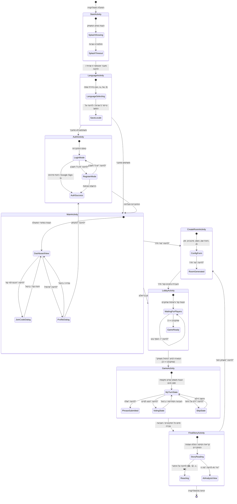
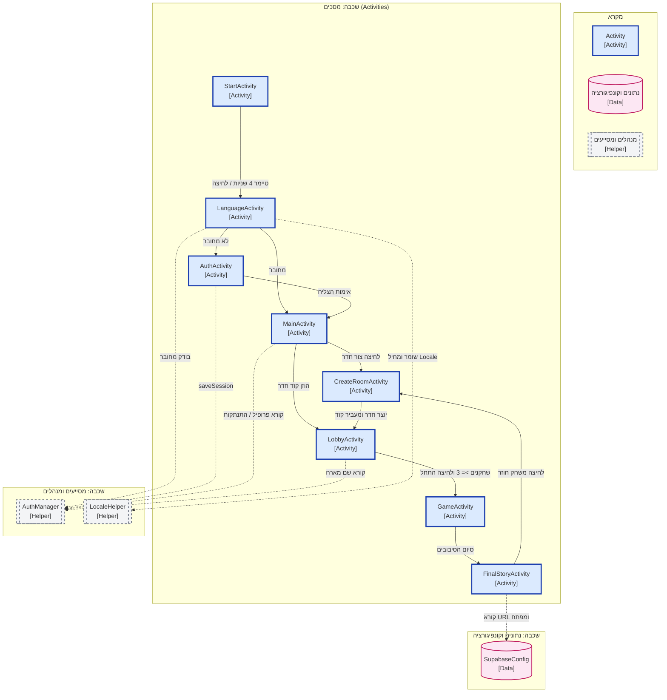

# 🧩 דיאגרמת ניווט ومצבים + מפת מחלקות וקשרים — "BlindStory"

---

## 1. דיאגרמה 1: ניווט ומצבים (Mermaid stateDiagram-v2)

---

## 2. דיאגרמה 2: מפת מחלקות וקשרים (Mermaid flowchart TD)

---

## 3. איך לקרוא את דיאגרמה 1

| אלמנט בדיאגרמה 1 | מה זה אומר |
|---|---|
| `[*]` בהתחלה ובסיום | נקודת הכניסה לאפליקציה / יציאה מהאפליקציה. |
| **מלבן מצב (State)** | מסך או מצב תצוגה של המשתמש (למשל `StartActivity`, `MyTurnState`). |
| **מצב מורכב (`state X { ... }`)** | מסך המכיל מצבים פנימיים (למשל מעבר בין התחברות להרשמה ב-`AuthActivity`). |
| **חץ מעבר** | אירוע או תנאי המעביר את האפליקציה ממצב אחד לאחר. |

---

## 4. איך לקרוא את דיאגרמה 2

| אלמנט בדיאגרמה 2 | צורה וצבע | סוג מחלקה ודוגמה |
|---|---|---|
| **Activity** | מלבן כחול `[ ]`, מסגרת עבה | `MainActivity [Activity]` |
| **Helper** | מלבן אפור מקווקו `[[ ]]` | `AuthManager [Helper]` |
| **Data** | צילינדר ורוד `[( )]` | `SupabaseConfig [Data]` |
| `-->` חץ מלא | קו רציף | **ניווט ומעבר מסכים** (`startActivity`, `Intent`). |
| `-.->` חץ מקווקו | קו מקווקו | **שימוש / קריאה לשיטה** (`AuthManager.isLoggedIn()`). |
| `==>` חץ מודגש | קו כפול | **זרימת נתונים** (`saveSession`, `loadLocale`). |

---

## 5. הסבר במילים פשוטות

### 💡 הרעיון המרכזי
בכל מילישניה, תוכנית מחשב נמצאת **בדיוק במצב אחד**. אירוע חיצוני (לחיצת כפתור, סיום טיימר, תשובת שרת) מעביר אותה למצב הבא. במדעי המחשב התיאורטיים, קוראים לזה **אוטומט סופי (Finite State Machine)**.

### 🚦 אנלוגיה מהחיים: מחסום במטרו / רכבת
- **מצב 1: נעול.** ממתין לכרטיס.
- **אירוע: העברת כרטיס.**
- **מעבר:** המנעול נפתח.
- **מצב 2: פתוח.** הנוסע עובר.
- **אירוע: החיישן מזהה מעבר.**
- **מעבר:** חוזר למצב 1 (נעול).

---

### 🔍 זמנים וערכים מדויקים מהקוד
1. **שרשרת ההפעלה:**
   - `StartActivity` מציגה את הלוגו ל-**4 שניות**.
   - `LanguageActivity` מציעה בחירת שפה ל-**5 שניות**. אם המשתמש לא נוגע, נשמרת ברירת המחדל (אנגלית `"en"`).
2. **תנאי 3 השחקנים בלובי:**
   - כפתור "התחל משחק" ב-`LobbyActivity` נעול כשיש פחות מ-3 שחקנים (*"דרושים לפחות 3 שחקנים (1/3)"*), ונפתח רק כשיש **≥ 3 שחקנים**.
3. **מגבלות במסך המשחק (`GameActivity`):**
   - טיימר תור של **60 שניות** (נדלק באדום ב-10 השניות האחרונות).
   - מגבלת תוים של **עד 180 תוים** (כפתור שליחה פעיל מ-2 עד 180 תוים).

---

## ❓ שאלות לבדיקה עצמית
1. **ערך מדויק:** כמה שניות מוצג מסך הפתיחה `StartActivity` לפני המעבר האוטומטי? (תשובה: 4 שניות).
2. **סף תנאי:** כמה שחקנים חייבים להיות בלובי כדי שכפתור "התחל משחק" יופעל? (תשובה: לפחות 3 שחקנים).
3. **מגבלת תוים:** מהו אורך הפראזה המרבי שניתן לשלוח במסך המשחק? (תשובה: 180 תוים).
4. **למה שתי דיאגרמות?** דיאגרמה 1 מראה *התנהגות ומצבי משתמש*, ודיאגרמה 2 מראה *מבנה קוד ותלויות*.
