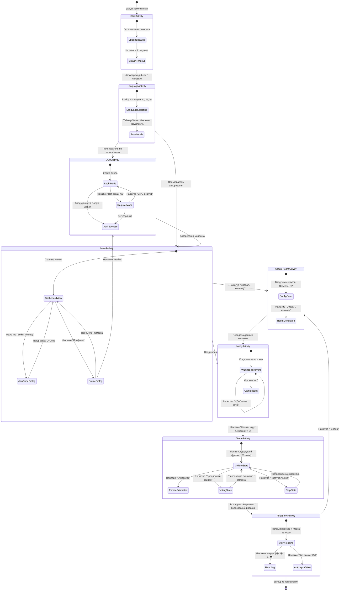
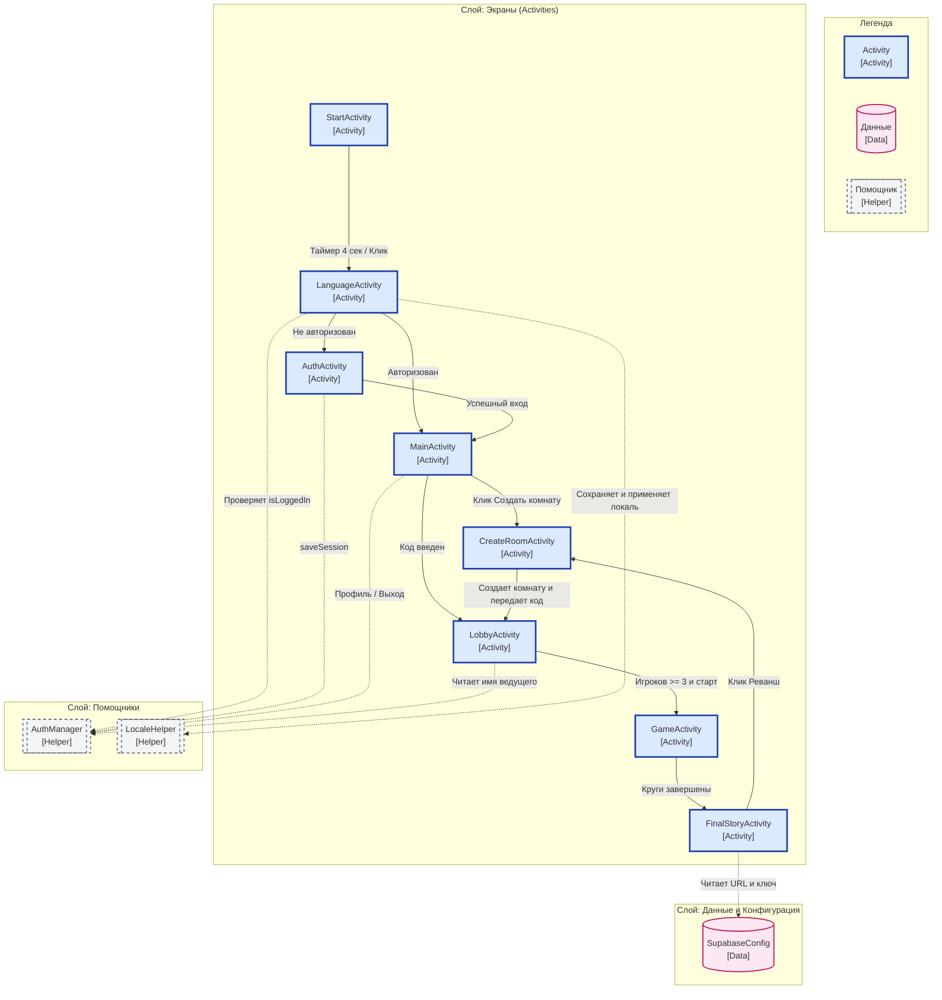

# 🧩 Диаграмма состояний, навигации и карта классов — «Слепой рассказ»

---

## 1. Диаграмма 1: Навигация и состояния (Mermaid stateDiagram-v2)

---

## 2. Диаграмма 2: Карта классов и связей (Mermaid flowchart TD)

---

## 3. Объяснение простыми словами

### 💡 Главная идея
В любой момент времени приложение находится **ровно в одном состоянии**. Внешнее событие (клик, таймер) переводит его в следующее состояние. В теории информатики это называется **Конечным автоматом (Finite State Machine)**.

### 🚦 Наглядная аналогия: Турникет в метро
- **Состояние 1: Заблокирован.** Ждет карту.
- **Событие: Прикосновение картой.**
- **Переход:** Замок открывается.
- **Состояние 2: Открыт.** Пассажир проходит.
- **Событие: Датчик фиксирует проход.**
- **Переход:** Возвращается в Состояние 1.

---

## ❓ Вопросы для самопроверки
1. **Точное значение:** Сколько секунд отображается `StartActivity` до автоматического перехода? (Ответ: 4 секунды).
2. **Порог:** Сколько игроков должно быть в лобби, чтобы кнопка «Начать игру» активировалась? (Ответ: минимум 3 игрока).
3. **Лимит:** Какова максимальная длина фразы в `GameActivity`? (Ответ: 180 символов).
