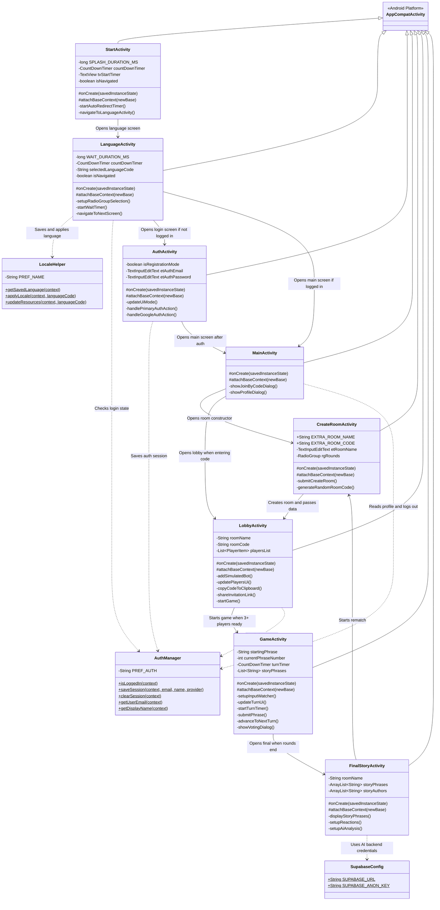

# 🧩 مخطط فئات UML وشرح تفصيلي — "BlindStory"

---

## 1. مخطط فئات UML (Mermaid classDiagram)

---

## 2. كيفية قراءة المخطط

| الرمز | المعنى |
|---|---|
| **مربع الفئة** | يمثل فئة Java (مثل `StartActivity`). |
| **الجزء العلوي** | اسم الفئة. |
| **الجزء الأوسط** | المتغيرات (الحقول). |
| **الجزء السفلي** | الدوال (الدوال والأساليب). |
| **علامة `+`** | عنصر عام (`public`). |
| **علامة `-`** | عنصر خاص (`private`). |
| **علامة `#`** | عنصر محمي (`protected`). |
| **علامة `$`** | عنصر ثابت (`static`). |
| **سهم `<|--`** | الوراثة (`extends`). |
| **سهم منقط `..>`** | الاعتمادية ("يستخدم"). |
| **سهم متصل `-->`** | الانتقال بين الشاشات (`Intent`). |

---

## 3. شرح بكلمات بسيطة

### 💡 الفكرة الرئيسية
كل فئة مسؤولة عن **دور واحد فقط**. تجزئة الأكواد تجعل التطبيق منظمًا وسهل التعديل.

### 🏠 تشبيه من الحياة: الفندق
- **الأنشطة (Activities):** القاعات والغرف في الفندق.
- **`AuthManager` (موظف الاستقبال):** يتحقق من هويات الزوار.
- **`LocaleHelper` (المترجم):** يضمن عرض اللافتات باللغة المناسبة.
- **`SupabaseConfig` (خزنة الفندق):** تحفظ مفاتيح الاتصال بالخادم.
