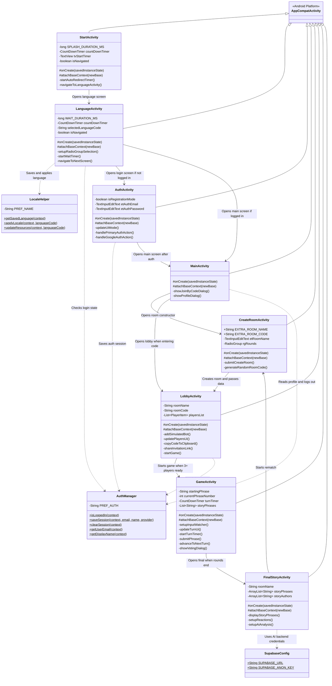

# 🧩 UML Class Diagram & Detailed Explanation — "BlindStory"

---

## 1. UML Class Diagram (Mermaid classDiagram)

---

## 2. How to Read the Diagram

| Symbol in Diagram | What It Means |
|---|---|
| **Class Box** | Representation of a Java Class (e.g. `StartActivity`). |
| **Top Section** | Class name. |
| **Middle Section** | Variables / Fields of the class. |
| **Bottom Section** | Methods / Functions of the class. |
| **`+` (Plus)** | `public` member — accessible from other classes. |
| **`-` (Minus)** | `private` member — accessible only inside this class. |
| **`#` (Hash)** | `protected` member — accessible to inheriting subclasses. |
| **`$` (Dollar)** | `static` member — belongs to the class itself. |
| **`<|--` Arrow** | Inheritance (`extends`) — subclass inherits base class features. |
| **`..>` Dashed Arrow** | Dependency ("Uses") — class calls methods of another class. |
| **`-->` Solid Arrow** | Association / Screen Navigation — navigation via `Intent`. |

---

## 3. Simplified Explanation

### 💡 Core Concept
Each class is responsible for **one single role**. The school principal doesn't clean floors, and the gym teacher doesn't teach math. Keeping single responsibilities makes code clean, reliable, and easy to maintain.

### 🏠 Real-Life Analogy: A Hotel
- **Activities:** Rooms and halls in the hotel (Lobby, Dining Room, Game Hall).
- **`AuthManager` (Reception Desk):** Checks room keys and verifies member status.
- **`LocaleHelper` (Hotel Interpreter):** Ensures signs and menus are translated to the guest's language.
- **`SupabaseConfig` (Hotel Safe):** Stores server address and secure access keys.

---

### 🏹 Reading Every Arrow
1. `AppCompatActivity <|-- StartActivity`: `StartActivity` inherits from `AppCompatActivity`.
2. `StartActivity --> LanguageActivity`: Splash screen navigates to language selection after 4s.
3. `LanguageActivity ..> LocaleHelper`: Language selection uses `LocaleHelper` to save locale.
4. `LanguageActivity ..> AuthManager`: Checks if user is logged in.
5. `LanguageActivity --> AuthActivity`: Redirects to login if unauthenticated.
6. `LanguageActivity --> MainActivity`: Redirects to main screen if logged in.
7. `AuthActivity ..> AuthManager`: Saves user session upon authentication.
8. `AuthActivity --> MainActivity`: Opens main dashboard after login.
9. `MainActivity --> CreateRoomActivity`: Opens room constructor.
10. `MainActivity --> LobbyActivity`: Opens lobby upon room code entry.
11. `MainActivity ..> AuthManager`: Reads user profile and performs logout.
12. `CreateRoomActivity --> LobbyActivity`: Generates room code and passes parameters.
13. `LobbyActivity --> GameActivity`: Launches active game when 3+ players join.
14. `LobbyActivity ..> AuthManager`: Fetches host display name.
15. `GameActivity --> FinalStoryActivity`: Navigates to final story view when rounds finish.
16. `FinalStoryActivity --> CreateRoomActivity`: Starts a rematch.
17. `FinalStoryActivity ..> SupabaseConfig`: Uses Supabase credentials for AI comments.

---

## ❓ Self-Check Questions
1. **Why?** Why is session storage separated into `AuthManager` instead of keeping it in `AuthActivity`?
2. **What if...** What happens if we remove `LocaleHelper.updateResources()` from `attachBaseContext()`?
3. **Diagram Search:** Find the class in the diagram responsible for enforcing character limits (up to 180 chars).
4. **Inheritance vs Dependency:** Which arrow connects `MainActivity` to `AppCompatActivity`, and which connects it to `AuthManager`?
