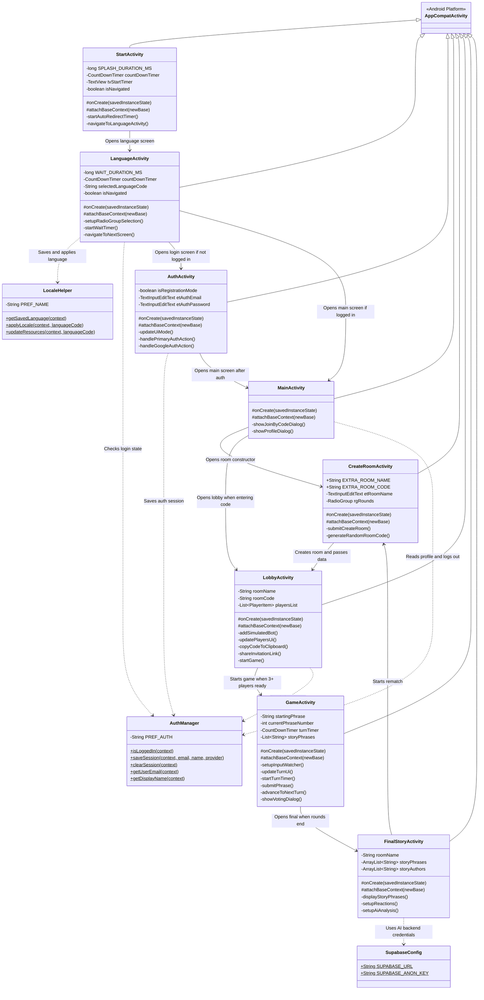

# 🧩 דיאגרמת מחלקות UML והסבר מפורט — "BlindStory"

---

## 1. דיאגרמת מחלקות UML (Mermaid classDiagram)



---

## 2. איך לקרוא את הדיאגרמה

| מה בדיאגרמה | מה זה אומר |
|---|---|
| **מלבן של מחלקה** | ייצוג של מחלקה ב-Java (למשל `StartActivity`). |
| **חלק עליון של מלבן** | שם המחלקה. |
| **חלק אמצעי של מלבן** | משתנים (שדות) של המחלקה. |
| **חלקי תחתון של מלבן** | מתודות (פונקציות) של המחלקה. |
| **סימן `+` (פלוס)** | איבר ציבורי (`public`) — פתוח לגישה ממחלקות אחרות. |
| **סימן `-` (מינוס)** | איבר פרטי (`private`) — נגיש אך ורק מתוך מחלקה זו. |
| **סימן `#` (סולמית)** | איבר מוגן (`protected`) — נגיש למחלקות יורשות. |
| **סימן `$` בסוף** | מתודה/שדה סטטי (`static`) — שייך למחלקה עצמה ולא למופע ספציפי. |
| **חץ ירושה `<|--`** | הורשה (`extends`) — המחלקה היורשת מקבלת את התכונות של המחלקה הראשית. |
| **חץ מקווקו `..>`** | תלות ("משתמש ב-") — המחלקה קוראת לשיטות של מחלקה אחרת אך אינה שומרת אותה כחלק ממנה. |
| **חץ רגיל `-->`** | אסוציאציה ומעבר מסכים — מעבר מ-Activity אחת לאחרת בעזרת `Intent`. |

---

## 3. הסבר במילים פשוטות

### 💡 הרעיון המרכזי
בפיתוח תוכנה, כל מחלקה אחראית על **תפקיד אחד בלבד**. המנהל בבית ספר אינו שוטף את הרצפה, והמורה לספורט אינו מלמד מתמטיקה. כשיש לכל מחלקה אחריות מוגדרת, הקוד נשאר נקי, קל להבנה וקל לתיקון.

### 🏫 אנלוגיה מהחיים: בית מלון
- **האקטיביטיז (Activities):** הם החדרים והאולמות השונים במלון (הלובי, חדר האוכל, אולם המשחקים).
- **`AuthManager` (פקיד הקבלה):** בודק למי יש מפתח לחדר והאם האורח רשום.
- **`LocaleHelper` (המתרגם של המלון):** דואג שכל השלטים בבית המלון יהיו בשפה שהאורח מבין.
- **`SupabaseConfig` (כספת המלון):** שומרת את כתובת השרת והמפתחות הסודיים.

### 📦 קבוצות המחלקות
1. **מחלקות מסכים (Activities):** `StartActivity`, `LanguageActivity`, `AuthActivity`, `MainActivity`, `CreateRoomActivity`, `LobbyActivity`, `GameActivity`, `FinalStoryActivity`.
   - *תפקיד:* הצגת ממשק המשתמש וטיפול בלחיצות.
2. **מחלקות שירות ועזר (Helpers & Managers):** `AuthManager`, `LocaleHelper`, `SupabaseConfig`.
   - *תפקיד:* שמירת זיכרון מקומי, ניהול שפות והגדרות שרת.

---

### 🏹 איך לקרוא את החצים בדיאגרמה

1. **`AppCompatActivity <|-- StartActivity`**: `StartActivity` יורשת מ-`AppCompatActivity` מכיוון שהיא מסך אנדרואיד תקני.
2. **`StartActivity --> LanguageActivity`**: מסך הפתיחה עובר למסך בחירת השפה בתום 4 שניות.
3. **`LanguageActivity ..> LocaleHelper`**: מסך בחירת השפה משתמש ב-`LocaleHelper` כדי לשמור את השפה שנבחרה.
4. **`LanguageActivity ..> AuthManager`**: מסך בחירת השפה בודק ב-`AuthManager` אם המשתמש כבר מחובר.
5. **`LanguageActivity --> AuthActivity`**: עובר למסך ההתחברות אם המשתמש לא מחובר.
6. **`LanguageActivity --> MainActivity`**: עובר ישירות למסך הראשי אם המשתמש כבר מחובר.
7. **`AuthActivity ..> AuthManager`**: מסך ההתחברות שומר את סשן המשתמש לאחר אימות מצליח.
8. **`AuthActivity --> MainActivity`**: עובר למסך הראשי לאחר סיום ההתחברות.
9. **`MainActivity --> CreateRoomActivity`**: המסך הראשי פותח את בונה החדר בלחיצה על "צור חדר".
10. **`MainActivity --> LobbyActivity`**: המסך הראשי פותח את הלובי באופן ישיר בעת הזנת קוד חדר.
11. **`MainActivity ..> AuthManager`**: המסך הראשי קורא את פרופיל המשתמש ומבצע התנתקות.
12. **`CreateRoomActivity --> LobbyActivity`**: בונה החדר יוצר קוד אקראי ומעביר את הנתונים ללובי.
13. **`LobbyActivity --> GameActivity`**: הלובי מפעיל את המשחק כשיש לפחות 3 שחקנים מוכנים.
14. **`LobbyActivity ..> AuthManager`**: הלובי שולף את שם המארח (Host).
15. **`GameActivity --> FinalStoryActivity`**: מסך המשחק מעביר את כל פראזות הסיפור למסך הסיום בתום הסיבובים.
16. **`FinalStoryActivity --> CreateRoomActivity`**: מסך הסיום מאפשר להתחיל "משחק חוזר".
17. **`FinalStoryActivity ..> SupabaseConfig`**: מסך הסיום משתמש בהגדרות Supabase לקבלת ניתוח ה-AI.

---

### 💻 קשר לקוד Java (איך החצים נראים בקוד)

#### דוגמה 1: הורשה (`extends`)
```java
// AppCompatActivity <|-- StartActivity
public class StartActivity extends AppCompatActivity {
    // ...
}
```

#### דוגמה 2: תלות וקריאה לשיטה סטטית (`..>`)
```java
// LanguageActivity ..> AuthManager
if (AuthManager.isLoggedIn(this)) {
    // המשתמש מחובר
}
```

#### דוגמה 3: מעבר מסכים בעזרת Intent (`-->`)
```java
// MainActivity --> CreateRoomActivity
Intent intent = new Intent(MainActivity.this, CreateRoomActivity.class);
startActivity(intent);
```

---

### ⚠️ מה חשוב לזכור
1. **הפרדת אחריות:** `GameActivity` לא מנהלת שפות — היא מבקשת זאת מ-`LocaleHelper`.
2. **למה נחוץ `private` (`-`):** שדות פרטיים מונעים משינוי לא רצוי של נתונים מחוץ למחלקה.
3. **הבדל בין תלות (`..>`) להורשה (`<|--`):** הורשה אומרת "הוא סוג של" (`StartActivity` היא מסך), ואילו תלות אומרת "הוא משתמש ב-" (`LanguageActivity` משתמשת ב-`AuthManager`).

### ❌ טעויות נפוצות של תלמידים
1. **בלבול בין מעבר מסך להורשה:** לחיצה על כפתור שעוברת למסך אחר היא **אסוציאציה (`-->`)**, ולא הורשה (`extends`).
2. **שכחת ביטול טיימרים:** אי-ביטול `CountDownTimer` ב-`onDestroy()` גורם לדליפת זיכרון.

---

## ❓ שאלות לבדיקה עצמית

1. **למה?** מדוע שמירת נתוני המשתמש מבוצעת ב-`AuthManager` ולא בתוך `AuthActivity`?
2. **מה ישתנה אם...** מה יקרה אם נמחק את הקריאה ל-`LocaleHelper.updateResources()` משיטת `attachBaseContext()`?
3. **מציאה בדיאגרמה:** מצא בדיאגרמה איזו מחלקה אחראית על ניהול ספירת התוים של הפראזה (עד 180 תוים).
4. **תלות מול הורשה:** באיזה חץ משתמשת `MainActivity` מול `AppCompatActivity`, ובאיזה חץ מול `AuthManager`?
