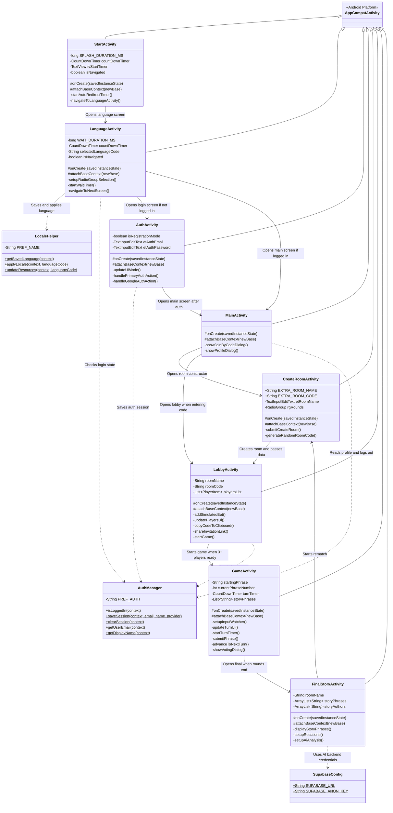

# 🧩 UML Диаграмма классов и подробное объяснение — «Слепой рассказ»

---

## 1. UML Диаграмма классов (Mermaid classDiagram)

---

## 2. Как читать диаграмму

| Символ на диаграмме | Что это значит |
|---|---|
| **Прямоугольник класса** | Обозначение класса в Java (например `StartActivity`). |
| **Верхняя часть** | Имя класса. |
| **Средняя часть** | Переменные (поля) класса. |
| **Нижняя часть** | Методы (функции) класса. |
| **Знак `+` (Плюс)** | `public` — публичный доступ из любых классов. |
| **Знак `-` (Минус)** | `private` — приватный доступ только внутри этого класса. |
| **Знак `#` (Решетка)** | `protected` — доступен дочерним классам. |
| **Знак `$` (Доллар)** | `static` — статический элемент, принадлежащий самому классу. |
| **Сплошная стрелка с треугольником `<|--`** | Наследование (`extends`). |
| **Пунктирная стрелка `..>`** | Зависимость («Использует»). |
| **Сплошная стрелка `-->`** | Ассоциация и переход между экранами (`Intent`). |

---

## 3. Объяснение простыми словами

### 💡 Главная идея
Каждый класс отвечает за **одну конкретную задачу**. Директор школы не моет полы, а учитель физкультуры не ведет математику. Разделение обязанностей делает код чистым, понятным и надежным.

### 🏠 Наглядная аналогия: Отель
- **Activity (Экраны):** Холлы и номера отеля (Лобби, Ресторан, Игровой зал).
- **`AuthManager` (Администратор на ресепшн):** Проверяет ключи и регистрирует гостей.
- **`LocaleHelper` (Переводчик отеля):** Следит, чтобы все таблички были на языке гостя.
- **`SupabaseConfig` (Сейф отеля):** Хранит адреса и ключи доступа к серверу.

---

## ❓ Вопросы для самопроверки
1. **Почему?** Почему логика сессии выделена в `AuthManager`, а не хранится внутри `AuthActivity`?
2. **Что изменится, если...** Что произойдет, если мы удалим `LocaleHelper.updateResources()` из `attachBaseContext()`?
3. **Поиск по диаграмме:** Найдите класс, отвечающий за ограничение символов (до 180).
4. **Наследование против зависимости:** Какая стрелка соединяет `MainActivity` с `AppCompatActivity`, а какая с `AuthManager`?
